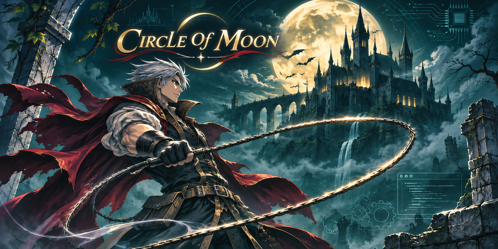
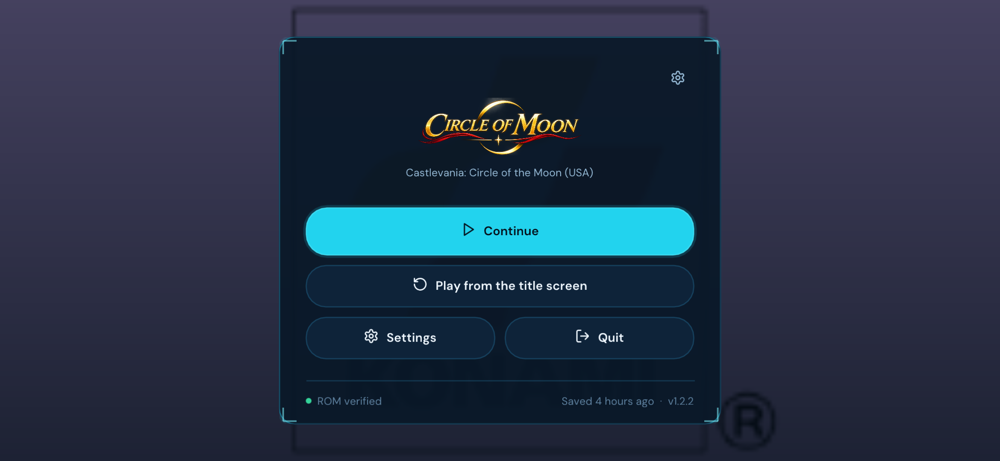

<p align="center">
  
</p>

<p align="center">
  
</p>

<h1 align="center">CircleMoon — Android Recomp</h1>

<p align="center">
  <a href="README.md">English</a> | <b>Português (Brasil)</b>
</p>

<p align="center">
  Port nativo para <b>Android (arm64-v8a)</b> e <b>Samsung DeX</b> de <i>Castlevania: Circle of the Moon</i>, com interface <b>Cyan Glass Gothic</b> redesenhada para uso com controle físico.
</p>

<p align="center">
  <a href="https://github.com/piecarlos/circle-of-moon-recomp/releases/tag/v1.2.4"></a>
  <a href="LICENSE"></a>
  
</p>

> [!IMPORTANT]
> Este repositório **não inclui ROMs nem APKs**. Você precisa fornecer seu próprio dump legal de **Castlevania: Circle of the Moon (USA)** (`AGB-AAME`, revisão 0).
> Projeto não oficial feito por fãs, sem afiliação com a Konami.

## Download

Baixe o **APK para Android (`arm64-v8a`, sem ROM inclusa)** na página de [Releases do GitHub](https://github.com/piecarlos/circle-of-moon-recomp/releases/latest), instale no seu aparelho e selecione sua própria ROM `.gba` na primeira abertura.

---

## Tela Inicial

<p align="center">
  
</p>

## Principais Recursos (Android)

- **Interface Cyan Glass Gothic:** Tela inicial com botões *pill*, atalho rápido de configurações no topo e menus redesenhados em vidro azul meia-noite com destaque ciano.
- **Navegação 100% por Controle:** Suporte completo a D-pad e **analógico esquerdo** na tela inicial, menus de configuração e lista simplificada de **Save States** (10 slots com miniatura, `Load`, `Save`, `Undo` e `Delete`).
- **Controles na Tela Opcionais (Touch Overlay):** Desativado por padrão para quem usa controle físico ou DeX; habilite **On-screen touch controls** em **Settings → Controls → Touchscreen** (com ajuste de opacidade).
- **Atalho Exclusivo do Menu:** Pressione **L2** a qualquer momento no jogo para abrir ou fechar o menu do recomp (mantendo `Start` e `Select` livres para o jogo).
- **Áudio e Performance Otimizados:** Compilação nativa com `-O2`, buffer de áudio ajustado para Android (`512` frames + controle dinâmico de taxa) e suporte a modo janela / fullscreen imersivo no **Samsung DeX**.
- **Extras:** Widescreen (16:9 / 16:10), Rewind (`L3`), Fast Forward (`R3`), Save States rápidos, Cheats e RetroAchievements.

## Controles Padrão (Gamepad)

| Ação | Controle |
| :--- | :--- |
| **Mover** | D-Pad / Analógico Esquerdo |
| **A / B** | Sul / Leste (ou Norte / Oeste) |
| **L / R** | L1 / R1 (e R2 para R) |
| **Start / Select** | Start / Select |
| **Abrir / Fechar Menu do Recomp** | **L2** (ou botão Voltar do Android) |
| **Rewind (segurar)** | **L3** |
| **Fast Forward (segurar)** | **R3** |
| **Quick Save / Quick Load** | Select + R1 / Select + L1 |

## Como Usar

1. Instale o APK no seu aparelho Android (`arm64-v8a`, Android 8.0+ / API 26+).
2. Na primeira abertura, toque em **Choose ROM...** e selecione seu arquivo `.gba` válido de *Castlevania: Circle of the Moon (USA)* (o app copia o arquivo com segurança para o armazenamento interno privado).
3. *(Opcional)* Para testes via ADB:
   ```powershell
   adb push "Castlevania - Circle of the Moon (USA).gba" /sdcard/Android/data/org.circlemoon.app/files/rom/circlemoon.gba
   ```

## Compilação (Android)

Requisitos: **JDK 17**, **Android SDK 35**, **NDK 28.2.13676358** e **CMake 3.31.6**.

```powershell
$env:JAVA_HOME = "C:\caminho\para\jdk-17"
$env:ANDROID_HOME = "C:\caminho\para\Android\Sdk"
cd android
.\gradlew.bat assembleRelease
```

O APK será gerado em `android/app/build/outputs/apk/release/app-release.apk`.
